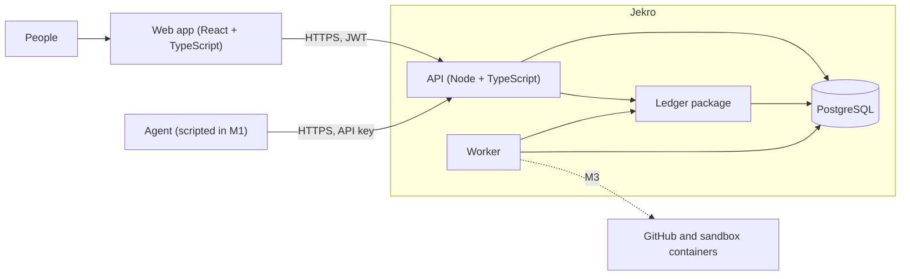
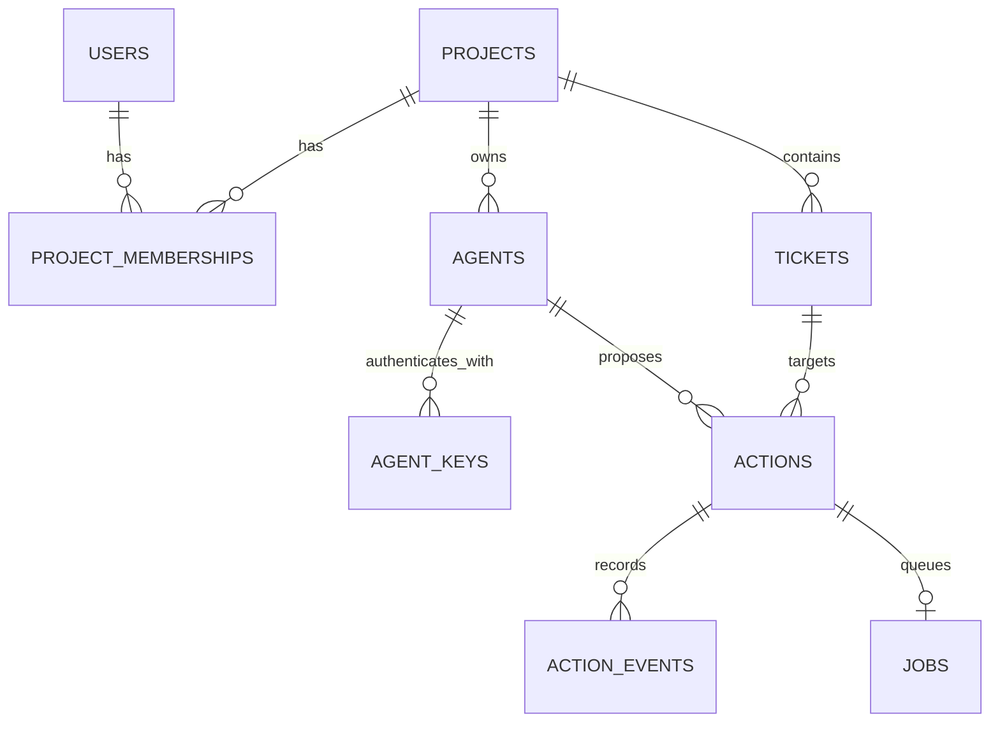
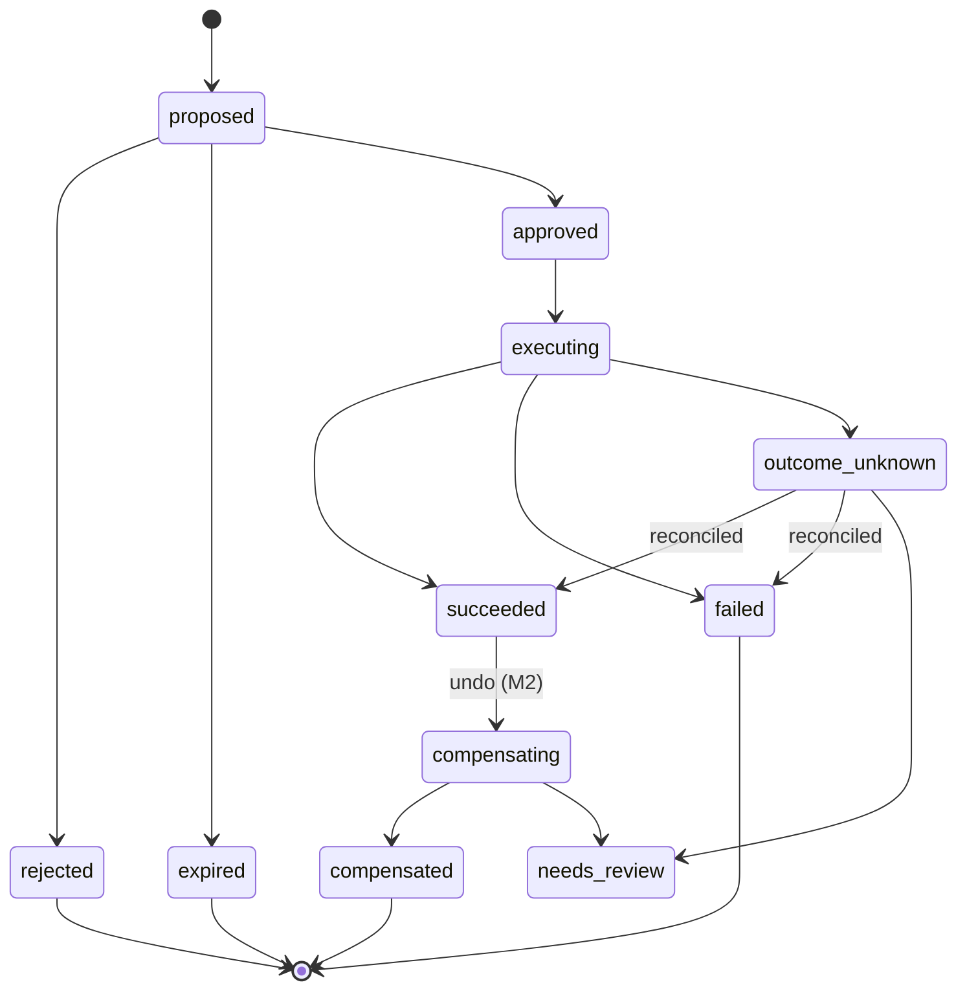

# Jekro: Architecture

**Status:** Draft v0.2, 2026-11-16
**Scope:** Detailed for M1 (target 2026-12-31). Interfaces and extension points for M2 and M3.
**Related:** `docs/prd.md`, `docs/roadmap.md`, `docs/adr/`

Choices marked "proposed" in section 15 are recorded as decision records in `docs/adr/`.

### Changes from v0.1

- One approval mechanism for both people and policy rules (6.1).
- Proposals record the ticket version they assumed, with a per-action staleness rule (6.2, 6.3).
- Proposals expire, with a new `expired` state (6, 6.2).
- Job leases carry a fencing token (9).
- Authorization is re-checked at execution time (6.5).
- Authorization rules are mandatory for M1 (7.1).

---

## 1. Design principles

1. **Modular monolith.** One API, one worker, one web app, one database. No microservices.
2. **Postgres is the system of record and, in M1, the job queue.** Fewer moving parts, and an action's state change and its queued job can commit in a single transaction.
3. **The ledger is a separate package** with a narrow interface and no knowledge of tickets. The tracker is its first integration.
4. **Agents are principals.** Every agent action goes through the ledger, and agent code runs outside the API process.
5. **Default deny.** Every route checks identity, then project membership and role, then (for agents) scope.
6. **Ticket text and repository content are untrusted input.**
7. **Honest guarantees.** Each action type states its execution class, and the system never claims more than that class supports.

## 2. System context



## 3. Repository layout

```
jekro/
  apps/
    api/        HTTP API: auth, projects, tickets, agents, action endpoints
    web/        React + TypeScript (Vite)
    worker/     Claims approved actions and executes them; runs scripted agents (M1)
  packages/
    ledger/     Action state machine, approvals, idempotency, audit events.
                No HTTP code and no knowledge of tickets.
    shared/     zod schemas and TypeScript types used by the API and the web app
    harness/    Fault injection and invariant tests (M2)
  docs/         prd.md, architecture.md, adr/, roadmap.md
  docker-compose.yml
  .github/workflows/
```

A workspace manager (pnpm workspaces) ties these together so the API and web app share types.

## 4. Components

| Component | Responsibility | Notes |
|---|---|---|
| Web app | Tickets, approvals screen with diff view | Talks only to the API |
| API | Authentication, authorization, validation, ticket and project operations, action endpoints | Stateless, so it can run as several instances |
| Ledger package | Owns action lifecycle, approval binding, idempotency, event log | All writes to action tables go through it |
| Worker | Claims jobs, executes approved actions, runs the scripted agent | Separate process from the API |
| PostgreSQL | Tickets, memberships, actions, events, jobs | Also the queue in M1 |
| Agent runner (M3) | Runs coding agents in sandboxes | Outside the API process |
| MCP server (M3) | Exposes propose, approve, and status to external agents | Thin layer over the API |

## 5. Data model



Key points:

- **Tickets** have a `version` integer incremented on every update. A ticket is assigned to a user or an agent, never both (a check constraint enforces this).
- **Agents** belong to one project. **Agent keys** store only a hash and a short prefix. The raw key is shown once at creation and can be revoked.
- **Actions** hold the type, target, payload, a preview (the proposed diff), `payload_hash`, `base_version` (the ticket version the proposal assumed), `expires_at`, effect class, execution class, state, the idempotency key, who proposed, the approval (see 6.1), and the result. Idempotency keys are unique per project and agent.
- **Action events** are append-only: the lifecycle of each action as ordered rows. M2 adds a hash chain over them.
- **Jobs** are the queue: available time, attempts, `lease_token`, `lease_expires_at`, and the action they run.
- **Migrations** are versioned SQL files, run in CI against a fresh database and against the previous schema.
- **Row-level security** policies on tickets, actions, and events add defense in depth beyond the application's own checks. Proposed for M1 if time allows, otherwise M2.

## 6. Action lifecycle



Rules:

- Every transition is one conditional update, for example `UPDATE actions SET state = 'executing' WHERE id = $1 AND state = 'approved'`. If no row changes, someone else already moved it.
- An action ends in `succeeded`, `failed`, `rejected`, `expired`, `compensated`, or `needs_review`. It is never silently dropped.
- `failed` always carries a cause, such as `stale_proposal`, `agent_revoked`, `scope_changed`, or `execution_error`.
- `outcome_unknown` and `needs_review` exist so the system never reports a success it cannot prove.
- In M1, the states through `succeeded`, `failed`, `rejected`, and `expired` are implemented, plus `needs_review` as a parking state.

### 6.1 Proposal to execution

```mermaid
sequenceDiagram
  participant A as Agent
  participant API as API
  participant L as Ledger
  participant DB as PostgreSQL
  participant H as Approver
  participant W as Worker
  A->>API: POST /actions (API key, Idempotency-Key)
  API->>L: propose(action)
  L->>DB: insert action (proposed) with preview, payload_hash, base_version, expires_at, first event
  alt policy auto-approves
    L->>DB: record approval by policy rule, set approved, enqueue job (one transaction)
    L-->>API: approved
    API-->>A: 202 Accepted (action id)
  else approval required
    L-->>API: pending
    API-->>A: 202 Accepted (action id)
    H->>API: GET /actions/:id (view the diff)
    H->>API: POST /actions/:id/approve (payload_hash)
    API->>L: approve(id, approver, hash)
    L->>DB: verify hash, expiry, and base_version; record approval by person; set approved; enqueue job (one transaction)
  end
  W->>DB: claim job (FOR UPDATE SKIP LOCKED), receive lease token
  W->>L: execute(action, lease token)
  L->>DB: re-check agent and scope, apply effect, set succeeded, append event, close job (one transaction, conditional on the lease token)
```

**There is one approval mechanism.** An approval is a recorded event with an approver, who is either a person or a policy rule (stored with the rule's id and version). Auto-approval and human approval run the same transition from `proposed` to `approved`, with the same checks (project, scope, expiry) and the same transactional enqueue. Only the approver's identity differs.

### 6.2 Idempotency, approval binding, staleness, and expiry

- **Idempotency:** a retried proposal with the same key and the same payload returns the original action. The same key with a different payload returns `409 Conflict`.
- **Approval binding:** `payload_hash` is a SHA-256 over a canonical form of the action type, target, payload, and preview. The approver submits the hash they saw. If it does not match the stored one, the approval is rejected. An approval therefore cannot be reused for a different change.
- **Stale proposals:** each proposal records `base_version`, the ticket version it assumed. Each action type has a staleness rule (see 6.3). For `strict` types, the check runs twice: at approval (the approver gets `409 Conflict`, and the agent must re-propose) and again at execution (the action fails with cause `stale_proposal`). `none` types skip the check. The approval screen flags "this ticket changed after the proposal."
- **Expiry:** a proposal expires after a configurable period (default 7 days). A sweeper in the worker moves overdue `proposed` actions to `expired`, and expired actions cannot be approved.

### 6.3 Execution classes

| Class | Where the effect happens | How the executor behaves |
|---|---|---|
| A. Internal | Only in Jekro's Postgres | One transaction applies the effect, sets the state, and appends the event. A crash before commit leaves nothing applied, and a re-run is safe because of the state guard. |
| B. External, provider-idempotent | An API that honors idempotency keys | Record intent, call with the key, record the result. Retries reuse the key. (M2) |
| C. External, needs reconciliation | An API without idempotency support, such as opening a pull request | Record intent, call, record the result. After an uncertain outcome, query the external system for evidence before retrying, or park the action in `outcome_unknown`. (M2 against a fake service, M3 against GitHub) |

M1 action types, all class A:

| Action type | Effect | Default policy | Staleness rule | Effect class (for undo in M2) |
|---|---|---|---|---|
| `add_comment` | Adds a comment to a ticket | Auto-approve | none | Compensatable (soft-delete the comment) |
| `set_priority` | Changes priority | Auto-approve | strict | Reversible |
| `assign_ticket` | Changes the assignee | Auto-approve | strict | Reversible |
| `set_status` | Changes status (closing is separate) | Auto-approve | strict | Reversible |
| `close_ticket` | Closes a ticket | Requires approval | strict | Reversible |
| `create_subticket` | Creates a child ticket | Requires approval | none | Compensatable (cancel it) |

### 6.4 Undo and conflict detection (M2)

Each executed action stores the fields it changed (before and after) and the ticket `version` it produced. An undo applies only if the ticket is still at that version. Otherwise it reports a conflict instead of overwriting a later change.

### 6.5 Authorization re-check at execution

Authorization can change between proposal and execution. Immediately before applying an effect, the executor re-checks that the agent is still active, that its scope still includes the action type, and that the project still exists. If any check fails, nothing is applied and the action fails with cause `agent_revoked` or `scope_changed`.

## 7. Authentication and authorization

- **People:** JWT access tokens (carried over from v1), with per-project roles.
- **Agents:** API keys scoped to one project and a list of allowed action types. Keys are stored hashed, shown once, revocable, and rate limited.
- **Check order on every request:** authenticate, then project membership and role, then (for agents) scope, then the ticket or action policy.

| Capability | Admin | Manager | Developer | Submitter | Agent |
|---|---|---|---|---|---|
| View tickets in the project | Yes | Yes | Yes | Yes | Within scope |
| Create tickets | Yes | Yes | Yes | Yes | Via action only |
| Update tickets | Yes | Yes | Yes | No | Via action only |
| Delete tickets | Yes | Yes | No | No | Via action only |
| Manage members | Yes | Yes (no Admin grants) | No | No | No |
| Grant the Admin role | Yes | No | No | No | No |
| Create or revoke agents | Yes | No | No | No | No |
| Approve or reject actions | Yes | Yes | No | No | No |
| Propose actions | No | No | No | No | Within scope |

### 7.1 Non-negotiable rules for M1

1. Every read and write of tickets, actions, and events is scoped to the authorized project. The data-access layer takes a required project scope, so an unscoped query cannot be written by accident.
2. Every privileged operation is authorized on the server. The web app may hide controls, but it never decides.
3. Cross-project access has automated tests. A table-driven integration test calls every endpoint, as a person and as an agent from a different project, and expects a denial.
4. Row-level security is defense in depth, not a substitute for rules 1 to 3.

## 8. API surface (M1)

| Area | Endpoints |
|---|---|
| Auth | `POST /auth/register`, `POST /auth/login`, `GET /auth/me` |
| Projects | `GET/POST /projects`, `GET/PATCH/DELETE /projects/:id` |
| Members | `GET/POST /projects/:id/members`, `PATCH/DELETE /projects/:id/members/:userId` |
| Tickets | `GET/POST /projects/:id/tickets`, `GET/PATCH/DELETE /tickets/:id` |
| Agents | `GET/POST /projects/:id/agents`, `POST /agents/:id/keys`, `DELETE /agents/:id/keys/:keyId` |
| Actions | `POST /actions`, `GET /actions/:id`, `GET /projects/:id/actions?state=`, `POST /actions/:id/approve`, `POST /actions/:id/reject` |
| History | `GET /tickets/:id/history` |
| Operations | `GET /healthz`, `GET /readyz` |

Conventions:
- JSON everywhere, validated with zod at the boundary, with schemas shared through the `shared` package.
- Errors use a consistent problem-details shape.
- List endpoints use cursor pagination.
- `Idempotency-Key` header on `POST /actions`.
- An OpenAPI document generated from the zod schemas.

## 9. Background processing

- **Queue:** a `jobs` table. Workers claim rows with `FOR UPDATE SKIP LOCKED`.
- **Lease and fencing:** claiming a job sets a random `lease_token` and a `lease_expires_at`. Long jobs renew the lease with a heartbeat. The worker's final transaction (apply the effect, set the action state, close the job) is conditional on its `lease_token`. If the lease expired and another worker claimed the job, the first worker's final update changes zero rows, so it aborts and discards its work.
- **Crash handling:** if a worker dies, its lease expires and the job becomes available again. For class A actions, execution is one transaction, so a stale worker cannot leave a half-applied effect. For classes B and C, effects happen outside the transaction, so the fencing token protects only Jekro's own bookkeeping. Duplicate external effects are handled by provider idempotency keys or reconciliation (6.3).
- **Retries:** exponential backoff with a maximum attempt count, then a dead-letter state surfaced as `needs_review`.
- **Maintenance work in the worker:** the proposal expiry sweeper and a lease reaper.
- **Why not Redis in M1:** one less service, and the state change and the enqueue commit together. The tradeoff is a lower throughput ceiling, which is fine at this scale. This is revisited if queue load ever becomes real.

## 10. Frontend

- React and TypeScript, built with Vite.
- Server state through TanStack Query. Types and request shapes come from the shared package.
- M1 screens: sign in, projects, ticket list and detail with action history, and a pending-approvals screen with a diff view.
- M2 adds real-time updates (server-sent events).
- Port the existing components, auth context, and API client. Rebuild the screens that currently show hardcoded data.

## 11. Testing strategy

| Layer | What it covers |
|---|---|
| Unit | State machine transitions, policy evaluation, hash computation, canonical JSON |
| Integration | API and ledger against a real Postgres (Testcontainers), including every authorization rule |
| Cross-project access | A table-driven test calls every endpoint as a person and as an agent from another project and expects a denial |
| Contract | Responses checked against the OpenAPI schema |
| Property-based | Random action sequences against the state machine, idempotency under retries |
| Fault injection (M2) | Killed workers, a stalled worker whose lease expires, duplicate delivery, a crash between effect and event |
| End to end | The demo scenario in a browser, kept small |

CI (GitHub Actions) runs lint, type checks, unit tests, and integration tests with a Postgres service, and builds the container images. Each authorization bug found in v1 gets a regression test.

## 12. Observability

- Structured JSON logs carrying `request_id` and `action_id`.
- OpenTelemetry traces across propose, approve, and execute.
- Metrics: actions by state, queue depth, execution latency.
- `GET /healthz` (process is up) and `GET /readyz` (database reachable).

## 13. Security: threats and mitigations

| Threat | Mitigation |
|---|---|
| Forged or reused approval | Approval bound to `payload_hash`, checked against the stored value |
| Replayed or duplicated requests | Idempotency keys and conditional state transitions |
| Privilege escalation through roles | Only Admins grant Admin, with tests; role checks centralized |
| Cross-project data exposure | Project-scoped queries, scoped user listings, row-level security |
| Stolen agent key | Keys hashed, shown once, scoped, revocable, rate limited |
| Prompt injection through ticket text (M3) | Agents get least-privilege tokens and no long-lived secrets; sandbox has no network by default; pull requests require approval |
| Audit tampering (M2) | Hash-chained events, an independent verifier, and the latest hash anchored outside the database |
| Abuse and floods | Rate limits on authentication and proposal endpoints |
| Approving a stale proposal | `base_version` checked at approval and again at execution |
| Approving an old proposal | Expiry, enforced at approval |
| Revoked or re-scoped agent with queued work | Authorization re-checked at execution; nothing is applied |
| Stalled worker committing after losing its lease | Fencing token on the final update |

## 14. Deployment and environments

- **Local:** Docker Compose runs Postgres, the API, the worker, and the web app with seed data, started with one command.
- **CI:** GitHub Actions, as above.
- **M1 hosting:** a small container host with a managed Postgres, to be chosen in a decision record.
- **Later:** Terraform for infrastructure, and a local Kubernetes setup, only after M3.

## 15. Proposed defaults for open questions

| Question | Proposed default | Why | Revisit when |
|---|---|---|---|
| API framework | Express with zod | The existing code is Express, so the port stays small | If a feature clearly needs Fastify's or NestJS's structure |
| Data access | SQL-first with a typed query builder (Kysely) and versioned SQL migrations | Transactions, `SKIP LOCKED`, and row-level security are first-class, not workarounds | If the query builder gets in the way |
| Job execution | Postgres queue | Transactional enqueue, one less service | If throughput requires it |
| How agents connect first | Direct HTTP API | Simplest to test and secure | M3, when the MCP server is added |
| Sandbox for M3 | Plain Docker containers with strict limits | Simplest to start with | If isolation needs outgrow it |
| GitHub access for M3 | A GitHub App | Short-lived, per-repository tokens | Decide at M3 |
| LLM provider and budget | Decide at M3 | Not needed before then | M3 |
| Hosting | Decide before the end of M1 | Needs a free or cheap tier with Postgres | End of M1 |
| Proposal lifetime | 7 days, configurable | Limits how long a stale proposal can be approved | If real usage shows it is too short or too long |

## 16. Known limitations and future work

- **M1:** the build order is in `docs/roadmap.md`: a thin end-to-end slice first, then hardening.
- **M2:** hash-chained audit log and verifier, undo with conflict detection, the fault-injection harness, execution classes B and C against a fake service, and real-time updates.
- **M3:** agent runner service, sandboxed execution, GitHub connector, real LLM integration, MCP server, and an evaluation suite on seeded bugs.
- **Later:** ticket search, Terraform deployment, a local Kubernetes setup.
- **Not covered here:** sandbox internals, prompt design, and evaluation design, which get their own documents in M3.
